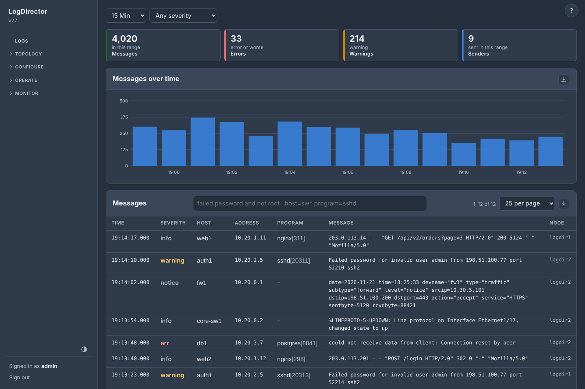
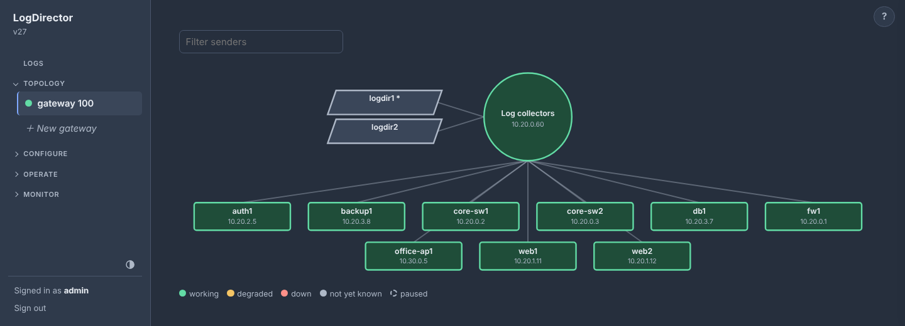
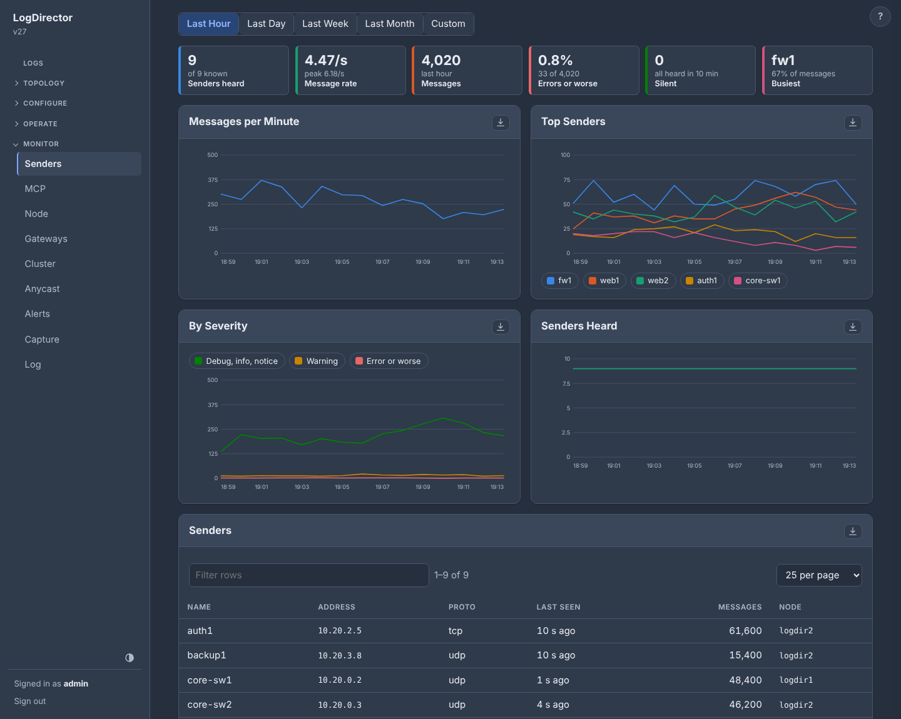

# LogDirector

LogDirector (`logdir`) collects syslog from your routers, switches, firewalls and servers, keeps it, and lets you search it from a web page or from an AI assistant. The assistant talks to the same address your devices send to, over [MCP](https://modelcontextprotocol.io), so you can ask it things like "what did web2 log around the time it fell over?", "who is noisy tonight?" or "did anyone fail to log in last night?".

It's one Go program with nothing outside the standard library. Run it on a few machines and they share one virtual IP, so losing a machine doesn't lose the address your devices log to.



The screenshots in this README come from a test install with made-up hosts and `example.net` names.

## What it does

Several nodes share a virtual IP (the gateway's **VIP**). They pick a controller among themselves and spread clients across all the nodes, so a node can fail or restart and your devices keep logging to the same address. If you'd rather have every site log to its nearest node, a gateway can also announce extra addresses to your routers over BGP or OSPF, through FRR. A node pulls those addresses back when it can't answer.

Syslog arrives over UDP, TCP and TLS, in RFC 3164 and RFC 5424 and in the odd formats Cisco, PAN-OS and others use instead. Every node stores what it received. A search asks every node and merges the answers by time, so a dead node costs you only what it held, and the page tells you which node didn't answer.

Syslog has no login, so logdir only accepts it from senders you list: a name and an address, a network, or a host name. Anything else is dropped before a byte is parsed.

You can also set up pattern alerts. When a search matches enough messages inside a time window, an alert opens, with the same webhook and silences the other alerts use.

The MCP endpoint is read-only. Callers get in by address list or bearer key, they can only search logs and look at the state of the cluster, public addresses are hidden from the assistant by default (see [Privacy levels](#privacy-levels)), and every call is logged. The whole cluster is managed from any node, from the web GUI or the command line: settings, config history, certificates and software updates stay in step.

## Contents

- [Status](#status)
- [How it works](#how-it-works)
- [Install, upgrade, uninstall](#install-upgrade-uninstall)
- [Connecting an assistant](#connecting-an-assistant)
- [MCP tools](#mcp-tools)
- [Security](#security)
- [MCP usage](#mcp-usage)
- [Privacy levels](#privacy-levels)
- [Clustering](#clustering)
- [Anycast addresses, BGP and OSPF](#anycast-addresses-bgp-and-ospf)
- [Neighbor discovery (LLDP)](#neighbor-discovery-lldp)
- [Log collector](#log-collector)
- [DNS registration](#dns-registration)
- [Configuration file](#configuration-file)
- [Build from source](#build-from-source)
- [License](#license)

## Status

Most of this is built in and in daily use. Here is where each piece lives.

| Area | State |
|---|---|
| VIP election, anycast, BGP, OSPF, LLDP, cluster, users, backups, scheduler, updates | built in |
| Log collector | syslog over UDP, TCP and TLS on the gateway addresses, kept per node and searched cluster-wide (`--logs-search`, MCP `logs_search`, `/api/logs/search`, **Logs** in the GUI) |
| Senders | **Configure ▸ Senders** (`settings.logs.senders`): a name and an address, a network or a host name; anything else is refused |
| Pattern alerts | **Configure ▸ Senders ▸ Pattern alerts** (`settings.logs.alerts`) |
| MCP | read-only: `logs_search`, `logs_tail`, `logs_stats`, `logs_senders`, `logs_status`, `list_nodes`, `get_topology` |
| Web GUI | Logs (the default page), Topology, Monitor, Configure |

## A look around the GUI

**Topology** draws each gateway with the nodes that serve it, and a square for every sender heard in the last 15 minutes. Green means a message in the last 5 minutes, amber 5 to 10, red 10 to 15, and after that it drops off the drawing. Click a square to see that sender's messages.



**Monitor ▸ Senders** is the page to open when you wonder who is logging and who has gone quiet. It has the message rate, the busiest senders, a severity breakdown and a table of every sender with its last-heard time and message count.



## How it works

A **gateway** is one shared address, its VIP (IPv4, IPv6 or both), served by several nodes. The nodes of a gateway find each other over multicast, or over a unicast list where multicast is blocked, and elect one **controller (AGC)**. The rest are **forwarders (AFN)**. The controller answers ARP and IPv6 neighbor solicitations for the VIP with the MAC address of a node chosen by the gateway's load-balancing method, which is how clients get spread over all the nodes. That MAC is either a virtual one per node, which another node takes over if the node fails, or the node's own. The own-MAC mode, called real-MAC mode, is the default for a new gateway.

Every node that is active or forwarding answers on the VIP, and on the gateway's other addresses, with a listener of its own that serves only the MCP endpoint, `/mcp`, on port 443 by default (`settings.mcp_port`). The GUI doesn't answer on those addresses. It listens on port 11154 of the node's own addresses. If a node's MCP listener stops serving, the node withdraws its anycast addresses so traffic goes to a node that can answer.

An answer to an assistant is at most 1 MB by default and gets cut, with a note, beyond that. `settings.mcp_max_result_mb` (Configure ▸ MCP ▸ Largest answer) raises it to 8 at most. The assistant reads the answer into its context, and 1 MB of text is roughly 250,000 tokens, so ask for less before you raise it.

## Install, upgrade, uninstall

Ubuntu, Debian, Fedora, RHEL, Rocky, Alma, Arch and Manjaro work, along with their derivatives. logdir is Linux-only, because it uses macvlan, AF_PACKET and inotify.

```
tar xzf logdir_vN.tgz && cd logdir      # N is the release you downloaded
sudo ./install.sh [--add-user NAME] [--no-start] [-y] [--dry-run]
sudo logdir-uninstall [--purge]
```

The installer builds logdir from the source tree with Go 1.24 or newer, and fetches a toolchain if your distribution's is too old. It installs only the prerequisites you're missing: gcc and the PAM headers, iproute2, FRR, nmap, ping and mtr, snmpd and lldpd. Then it sets up the `logdir` group, the PAM service, the systemd unit and `/var/lib/logdir`. Run it again on a newer tree to upgrade; if the new version fails to start, it rolls back to the old binary.

`QUICKSTART.md` takes you through a first gateway and connecting an assistant.

## Connecting an assistant

1. **Let the caller in.**
   - By address: add it to `settings.mcp_acl`, for example `"10.0.0.0/24"`. A privacy level can follow it, as in `"10.0.0.0/24 strict"` (see [Privacy levels](#privacy-levels)). An entry can end with a note after a `#` (`"10.0.0.20 # mike's laptop"`, one line, up to 200 characters). The note says what the entry is for and changes nothing.
   - Or with a key that works from any address. In the GUI: Configure ▸ MCP ▸ Keys, right-click, **Add key**. It shows the key once. In the file, `{"name": "laptop", "key": "<at least 32 random characters>"}` in `settings.mcp_keys` does the same. Only a SHA-256 hash of the key is kept.
   - You can switch an entry or a key off without deleting it: right-click ▸ **Disable**. In the file, an address then ends with `disabled` and a key gets `"disabled": true`. It lets nobody in until you enable it again.
   - Keys and address entries can both expire, in UTC: `"expires": <unix time>` on a key, `10.1.1.50 until=2026-12-31T17:00Z` on an address. After that time the key is refused as expired and the entry allows nothing. The row stays in the list.
2. **Give the gateway a certificate the client trusts.** The GUI starts with a self-signed one. Install yours with `logdir --tls-install --cert-file F --key-file F`. The primary's certificate is copied to every node.
3. **Point the client at the VIP.** For Claude Code:

```
claude mcp add --transport http logdir https://GATEWAY/mcp --header "Authorization: Bearer KEY"
```

The endpoint speaks MCP over streamable HTTP with JSON answers (protocol versions 2024-11-05 to 2025-11-25). Requests from a browser page on another origin are refused.

## MCP tools

| Tool | What it does |
|---|---|
| `logs_search` | the messages that match words (`failed password and not root`), a host, a program, a severity (this severe or worse), a sender (an address, or a name with `*` wildcards: `source=sw*.example.com`) fields (`action=deny`, `dst_port>1024`, `user=adm*`) and a time range, from every node, merged by time |
| `logs_tail` | the newest messages, or only what came after a time, so you can follow the log |
| `logs_stats` | how many messages match, by severity, by the busiest hosts and programs, and per interval |
| `logs_senders` | the senders and when each was last heard from, with the name each address reverse-looks-up to in DNS |
| `logs_status` | the collector on every node: what it listens on, counters, disk |
| `list_nodes`, `get_topology` | the cluster: the nodes (reachable, paused, primary, version, update state) and the gateways with their active node and anycast addresses |

That's all. An MCP caller can only read logs and the state of the cluster. There's no tool for logdir's own configuration, the GUI's API, alerts, the scheduler, updates, the host's load, LLDP, the log, users, backups or cluster tokens. No tool takes a `node` either: the node that serves the endpoint answers, and a `node` argument is refused. An administrator reads those things in the GUI or the CLI.

## Security

- **MCP reads and never writes.** Settings, the cluster, gateways, schedules, updates, alerts, users and certificates are changed in the GUI. The rule sits in the request path, so no route can slip past it.
- **Secrets never reach a caller.** Keys, SNMP communities, passwords and join codes read `(hidden)` to every MCP caller, and to read-only GUI accounts too.
- **Syslog isn't authenticated.** UDP and TCP syslog carry no login, so only the senders you list are read (Configure ▸ Senders). Anything else is dropped before a byte is parsed and counted as refused. TLS encrypts the connection, but the collector doesn't ask senders for a certificate, so it also relies on the sender's address. List only addresses that can't be spoofed from outside your network.
- **Everything is logged.** Each MCP call is logged with the caller's name (`KEYNAME@ADDRESS`, or just the address) and the tool.
- **Answers are data.** Whatever an answer holds (log messages, host names, sender names) is data for the assistant and never instructions. The MCP server says so in its instructions to the client.
- **Credentials live in the config file**, `/var/lib/logdir/logdir.conf`, mode 0600, owned by root. They are copied to the cluster's other nodes over the pinned, signed cluster channel.

## MCP usage

**Monitor ▸ MCP** shows what the MCP endpoint is used for on the node picked in the Node menu: calls by key (or *(address list)* when the caller got in by address), by source address and by tool, with errors, refused calls, data returned and average time. There's a chart of calls per hour and the newest 200 calls. It's laid out like Monitor ▸ Node, sits just below it in the menu, and offers the last hour, day or week.

The daemon keeps counts by the hour for 8 days (`mcpusage.json` in the state directory, so they survive a restart or an upgrade). The newest-calls list lives in memory. Only names, sizes and times are kept, never what a caller sent or got back. The same numbers are at `GET /api/mcpusage?window=24h`. Each node counts the calls it answers, so pick each node in turn to see a whole cluster.

## Privacy levels

The assistant is usually a public AI service, so you may not want it to see everything. Every answer is rewritten on its way out. A hidden address becomes `x.x.x.x` (or shows some of its parts), a hidden AS number shows its last three digits, an e-mail address shows only the part before the `@`, and a serial number or one of your own words becomes a token that's the same for the same value. Tokens change when the daemon restarts and can't be turned back into the value.

There are three levels.

| Level | Hides |
|---|---|
| `none` | nothing: every address is shown as it is. logdir's own keys and tokens stay hidden. Every such answer is logged. |
| `standard` (default) | public IP addresses and AS numbers, e-mail addresses, SNMP contact and location, serial numbers except the last four characters |
| `strict` | all of that, plus private IP addresses and AS numbers, MAC addresses, and serial numbers completely |

Configure ▸ Privacy sets the default level, for callers that have none of their own, and what `standard` and `strict` each hide: public and private addresses, AS numbers, e-mail addresses, contacts, serial numbers (shown, last four, or hidden), MAC addresses (shown, vendor part, last three bytes, or hidden), how many leading or trailing digits of a hidden address stay readable (`203.0.x.x`, or `x.x.114.7`), and a list of your own words, such as company, site and host names, that are always hidden. A key has a **Privacy** setting in Configure ▸ MCP ▸ Keys, and an allowed source has one in the same table. A caller that matches both a key and an address gets the stricter of the two.

In the file:

```json
"settings": {
  "mcp_acl": ["10.0.0.20 strict # mike's laptop", "10.0.0.0/24 none"],
  "mcp_keys": [{"name": "laptop", "access": "ro", "privacy": "strict", "notes": "for the audit", "key": "…"}],
  "privacy": {"default": "standard", "strict": {"public_ips": true, "private_ips": true, "ip_keep": -2,
    "public_asns": true, "private_asns": true, "serials": "hide", "macs": "nic", "emails": true,
    "contacts": true, "words": ["contoso", "lab-edge"]}}
}
```

Hiding is best effort. A value written in an unusual way, an address split over two fields, or a host name won't be recognised. With no `privacy` setting, the standard level applies.

## Clustering

Several nodes can be managed as one cluster. That's for management, and it's separate from the gateway election.

- **Roles.** One node is the primary and the others are replicas.
- **Shared and per-node settings.** The `settings` block, the gateways' VIPs, keys and timers, the web login groups and the sign-in rules are shared. You can edit them on any node and they're applied on the primary. Interface, priority, weight and the web and cluster blocks stay per node.
- **Joining.** Create a join code on a member (`--cluster-token`) and use it on the new node (`--cluster-join CODE`). A code works once, for an hour. A node keeps at most 20 unused codes, and `--cluster-token-clear` (Operate ▸ Cluster ▸ **Clear join codes**) withdraws them.
- **Trust.** Nodes pin each other's certificates and sign every request.
- **Promotion and failover.** You promote a node explicitly (`--cluster-promote`). With three or more members there's also automatic failover after 5 minutes, and the primary role is handed over before a planned restart. During an update that hand-over is temporary: the node that was primary when the update began is remembered, and once nothing is queued, installing or restarting for 30 seconds in a row, the role goes back to it. A failed update, a removed member, or a promotion by hand or by failover makes it forget. A plain restart or shutdown leaves the role where it landed.
- **Updates.** Upload a release archive on any node (`--update-upload`). Each node then builds it, swaps its binary and restarts, one at a time, with automatic rollback.

## Anycast addresses, BGP and OSPF

A gateway's anycast addresses (`extra_vips`) sit on `lo` of every node that runs the gateway, with a 10 s lifetime renewed every 3 s. FRR announces them over BGP (with BFD) or OSPF. An address is withdrawn when:

- the node's listener isn't serving,
- the gateway is paused or stops,
- no BGP neighbor of its family is established (and OSPF isn't carrying it), or
- logdir stops.

A `kill -9` takes it away within the lifetime. BGP and OSPF settings are per node: `--asn`, `--bgp-neighbor-add`, `--ospf-interface-add`. `logdir --help` has the rest.

## Neighbor discovery (LLDP)

With `settings.lldp` on, every node runs lldpd. The switches then see the nodes, and each node reports the switch port it's plugged into (`logdir --lldp`, and in the GUI). It's reporting only.

## Log collector

Point a device's syslog at a gateway address (a VIP, a further address or an anycast address) and list the device under **Configure ▸ Senders**. The collector listens on UDP 514, TCP 514 and TLS 6514 on every address of the node, so the node's own address works too. It also takes SNMP traps on UDP 162 (see below). A sender pointed at the VIP follows the active gateway: if that node fails, the messages go to the next one, and each node keeps what it received.

| Setting | Meaning |
|---|---|
| `enabled` | listen even with no sender listed (a sender entry also turns it on) |
| `udp_port`, `tcp_port`, `tls_port` | another port; `-1` turns that listener off |
| `trap_port` | the UDP port for SNMP traps, 162 by default; `-1` turns it off. It can't be the syslog UDP port |
| `trap_communities` | the community strings a trap must carry (up to 32); empty accepts any community from a listed sender |
| `senders` (Configure ▸ Senders) | the senders accepted: a `name` and an `address` (an IPv4 or IPv6 address, a network such as `10.9.0.0/16`, or a host name that DNS resolves, looked up again every minute). `"disabled": true` keeps an entry but refuses it. When entries overlap, the narrowest network wins |
| `retention_days` (Configure ▸ Settings ▸ General ▸ Log collector ▸ Keep) | delete hours older than this; 0 keeps them until the disk cap removes the oldest |
| `list_limit` (Configure ▸ Settings ▸ General ▸ Log collector ▸ Messages listed) | how many of the newest matching messages the Logs page lists, 100 to 5000, default 1000. The tiles and chart still count everything in the range |
| `follow` (Configure ▸ Settings ▸ General ▸ Log collector ▸ Follow new messages) | the Logs page shows new messages as they arrive, every 2 seconds, instead of reloading every 15. Off by default |
| `mem_max_percent` (… ▸ Memory cap) | cap on the cache of closed hours kept in memory for searches: this percent (default 50) of the machine's memory, or of the container limit when that's smaller, oldest hour first. The hour being written is never cached. Each node applies it to its own memory. Go's own memory limit is set 20 points above this (70% by default, at most 92%), so a large search can't push the process past what the machine allows; `GOMEMLIMIT` overrides it |
| `dir_max_percent` (… ▸ Disk cap) | cap on the folder: this percent (default 90) of the volume it's on, oldest hour first. Each node applies it to its own volume |
| `max_line` | longest message kept, in bytes (default 8192); more is cut off |
| `alerts` (Configure ▸ Senders ▸ Pattern alerts) | `name`, `query`, optional `host` and `min_severity` (0 to 7), `count` (default 1), `window_min` (default 5) and `disabled`; see below |
| `log_listen` (per node) | when set, listen only on these local addresses and on the gateway addresses this node serves, instead of on every address |
| `log_dir` (per node; … ▸ Storage folder) | the folder the segments are written to (default `logs` in the state directory); read when the daemon starts |

### SNMP traps

Point a device's trap host at a gateway address. The collector reads SNMP v1 and v2c traps and v2c informs on UDP 162, from listed senders only, and answers each inform from the address it was sent to. A trap is stored as a message from the program `snmptrap`, written as fields the Logs page can search and group:

```
trap=linkDown ifIndex=3 ifAdminStatus=up ifOperStatus=down ifDescr=GigabitEthernet0/3 uptime=2m3s
```

Common traps and objects are named without MIB files: the SNMPv2 generic traps, IF-MIB, BGP4 and Cisco BGP, OSPF, VRRP, ENTITY, RMON, UPS, PoE, LLDP, Cisco config, environment and syslog traps, and Juniper chassis traps. Anything else is written `oid_<OID>=value`. Traps that report a failure or something going down are warnings; the rest are notices; a Cisco syslog trap keeps the device's severity. SNMPv3 isn't read yet: such traps are counted (`logdir --logs`) and logged once per sender every 10 minutes. If snmptrapd runs on the host it holds port 162: stop it or set `trap_port`.

**What gets accepted.** RFC 5424 and RFC 3164 messages with or without a priority, ISO and BSD timestamps, Cisco sequence numbers and `*Mar  1 18:48:50.483 UTC:` stamps, and PAN-OS CSV bodies. Text that matches none of these is kept whole as the message. TCP and TLS take newline-framed lines and octet-counted frames (RFC 6587), told apart message by message. A message is stored with the time this node received it. Senders' clocks aren't trusted, and receive time is what every node can sort by. The sender's own timestamp is kept beside it when it could be read.

**What gets stored.** Everything accepted, except what a drop rule keeps out: Configure ▸ Senders ▸ Drop rules takes filters in the Logs page's language (`keepalive`, `action=accept and dst_port=53`, `program=ntpd` with *Info and debug*), and a message that matches one is never written, so it is not searched, counted, shipped or alerted on (each rule counts what it dropped). One file of JSON lines per hour (UTC), such as `2026112005.jsonl`, appended through a buffer that is written every second and before an update restarts the daemon. A closed hour is compressed (`.jsonl.lz`) and gets a small index beside it listing the hosts, programs and severities it holds, and a word index (`.wix`, a few KB: which three-letter pieces of text the hour holds), so a search reads only the hours that can hold what it asks for, words included. Retention and the disk cap delete whole hours, oldest first. To read a stored hour outside logdir, `logdir --logs-cat 2026112005.jsonl.lz | grep sshd` writes it as plain JSON lines. It reads the file only, so the daemon needn't be running, and you can give it several files.

**In the cluster.** Each message is stored on the node that received it. A search (`/api/logs/search`, `--logs-search`, the Logs page, `logs_search`) asks every node, merges the answers by time and keeps the newest up to the limit. A node that doesn't answer is named (`node_errors`), and what it holds is missing from the answer. A message a sender sent to two nodes is on both and shows up once. Counts (`logs_stats`) add the nodes up, so they count such a message twice.

**Searching.** Words are looked for in the host, the program, the message and the sender's name, in any case. `and`, `or` and `not` (or `!word`) combine them, and plain words side by side make one phrase. `host` and `program` take `*` wildcards, and `host=` matches the host name the message gives or the name of its sender. In the API and the CLI, `severity=err` means error or worse (emergency, alert, critical, error), and a trailing `=` (`severity=warning=`) means exactly that severity.

**The Host and Address columns.** Address is where the message was received from. Host is what the sender is called: the first part of its DNS name, else its name in Configure ▸ Senders, the same name the Senders page and the charts use. A sender that isn't in the list shows the host name its message gives. Hover over a host to see what the message itself says, when that's different. A firewall that calls itself `cush` in its messages while DNS knows it as `fw1-mgmt` shows up as `fw1-mgmt`.

**Pattern alerts.** Every minute, each node counts the messages it received that match each rule in its window. At `count` or more, the alert `Log pattern matched` opens, with the rule's name as its subject, and it closes when the count falls under. It uses the webhook, repeat and silences of **Configure ▸ Alerts**. Because every node counts its own, a burst that a failover splits between two nodes is counted in two parts.

**Limits.** A search reads the files of the hours in the range, so a very wide range over a busy store takes a while (a node that runs out of time says so). The word index rules out the closed hours that can't hold a word, but a common word is in most hours, and the two newest hours are always read. What a filter found in the closed hours is kept in memory (up to 64 MB), so the same search again, such as the Logs page's refresh, reads only the newest hours. Fields (`action=deny`, `dst_port=443`) are read from the message when a search runs, not stored: key=value, JSON, CEF, PAN-OS CSV, RFC 5424 structured data, Cisco `%FAC-SEV-MNEMONIC` and the ASA's deny messages; other vendor formats give no fields. Messages aren't replicated between nodes, so a failed node's disk is the only copy of what it held.

## DNS registration

Each node can put its own addresses into DNS, so its name follows the address it has (Configure ▸ Settings ▸ DNS, or `--dnsreg`). It uses RFC 2136 dynamic updates over TCP, signed with a TSIG key (hmac-md5, -sha1, -sha256, -sha384 or -sha512):

- `host.domain` gets the node's first IPv4 address (A) and first IPv6 address (AAAA).
- `host-interface.domain` gets every address of that interface.
- Each address gets a PTR record in its reverse zone (a /24 for IPv4, a /64 for IPv6), pointing at the first of its names.

The domain is the first search domain in `/etc/resolv.conf`, and the server is the primary named by the zone's SOA record, unless the `domain` and `server` settings say otherwise. A check runs every `interval_sec` (default 300, plus up to 30 % at random) and sends an update only for a record that's wrong or missing. Loopback, link-local and multicast addresses, interfaces that are down, interfaces matching `skip_interfaces`, and the gateways' own VIPs and anycast addresses are never registered under the node's name. The names given to a gateway are registered too: its VIP FQDN holds its shared addresses (A and AAAA) and its Anycast FQDN its anycast addresses, and each of those addresses gets a PTR record pointing back at its name (a paused anycast address gets neither), every node with registration turned on keeps them right. The setting is per node and never replicated (`dns_register` in the node's config file). The `key` is hidden from read-only accounts and from the troubleshooting bundle.

```
logdir --dnsreg-key ddns-key:c2VjcmV0c2VjcmV0 --dnsreg-enable
logdir --dnsreg-now        # check now and list every record
logdir --dnsreg-remove     # take this node's records out (turn registration off first)
```

## Configuration file

The config is `/var/lib/logdir/logdir.conf` (JSON, mode 0600). Changes apply live, because the daemon watches the file. `source/logdir.conf.example` is a starting point and `logdir --help` lists every key. The top-level blocks are:

- `groups`: the gateways
- `settings`: shared by the cluster
- `web`: the GUI and MCP listener
- `cluster`, `bgp`, `ospf`, `snmp`, `syslog`, `dns_register`, `log_level`

Every change, from any source, is kept as a version in `/var/lib/logdir/versions`. See `--versions`, `--version-diff` and `--version-restore`.

## Build from source

From `source/`:

```
go build -o logdir .
go test ./...                # Linux only
```

logdir uses Go's standard library only. The GUI's PAM login needs cgo and the PAM headers. A build without cgo serves no GUI, and with it no MCP endpoint.

## License

GPL-3.0; see `LICENSE`.
